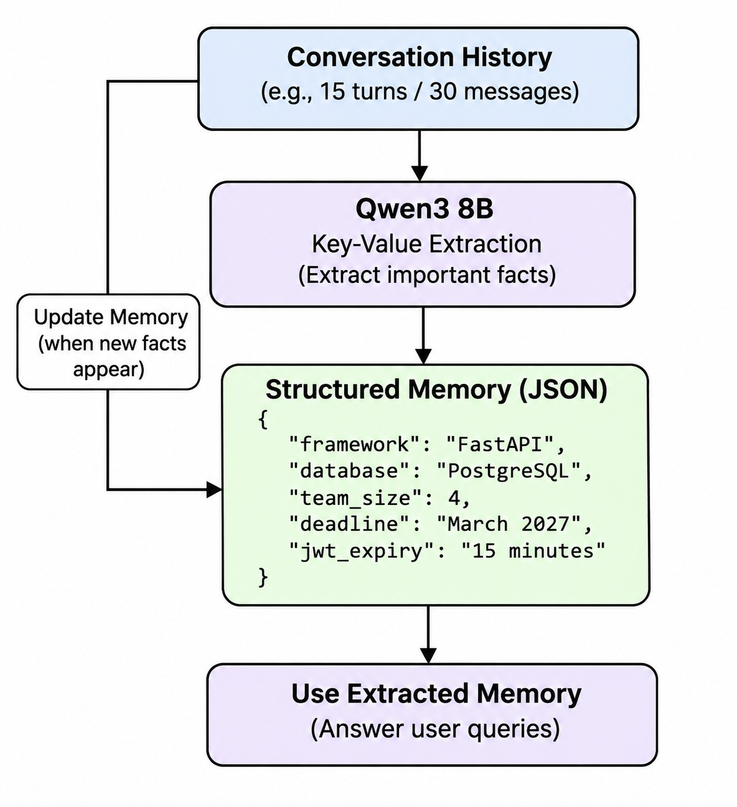
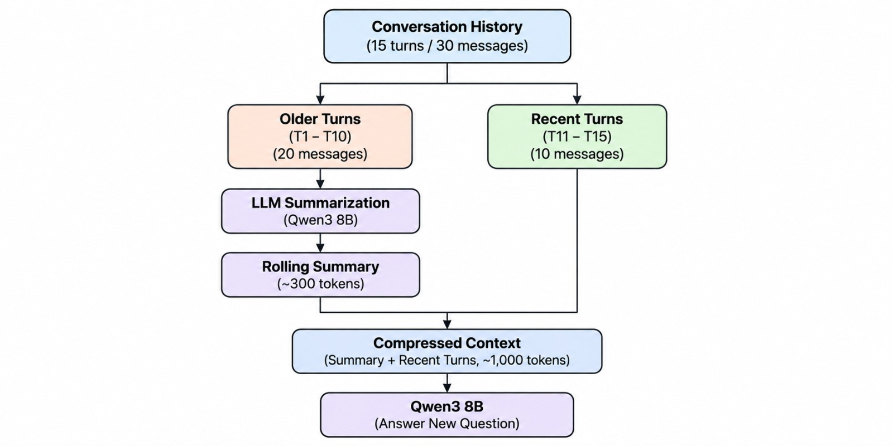
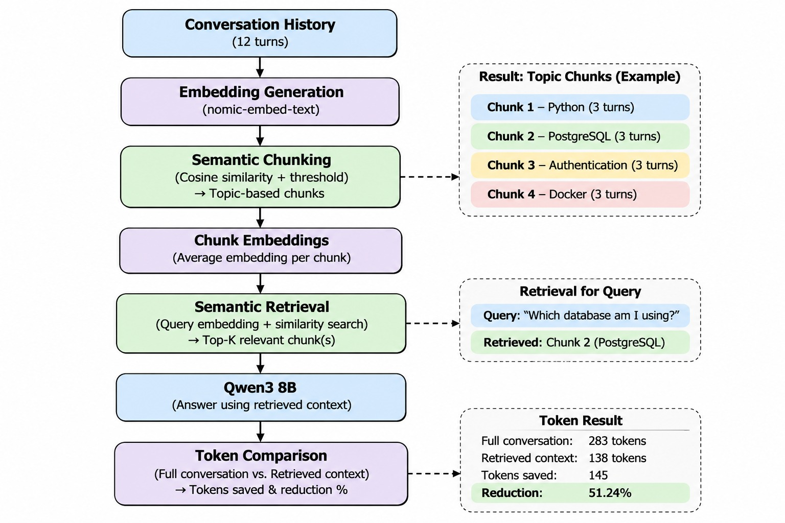
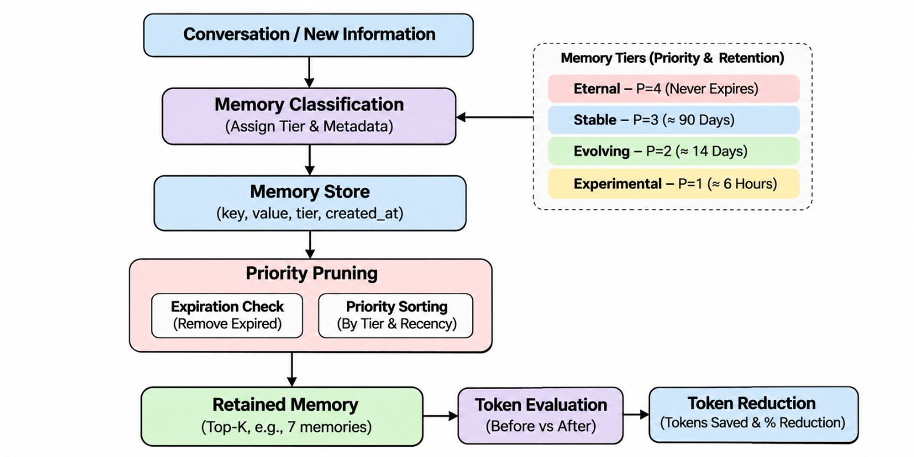

# Implementing Agentic Memory Systems with Qwen3 8B

> A hands-on exploration of how LLM-powered agents can retain, compress,
> retrieve, prioritize, and manage conversational context using a
> locally hosted model.

This repository implements and compares several memory-management
strategies using **Qwen3 8B through Ollama**.

The implementations use small, synthetic conversations so that each
strategy is easy to inspect and reproduce. They are educational
prototypes, not a production-ready memory service.

------------------------------------------------------------------------

## Why this project?

A language model does not automatically remember a previous, independent
API request. In a typical chat-completion workflow, the application must
provide the relevant prior messages or retrieve stored information and
include it in the next prompt.

Sending the entire conversation on every request is simple, but it can
become expensive and noisy as history grows. Conversely, discarding too
much context can make an agent forget decisions, preferences,
constraints, or unresolved tasks.

This project investigates the design space between those extremes.

**Core question:** How can an agent preserve the most useful information
while controlling prompt size and avoiding loss of important context?

## Implementations

The repository progresses from simple baselines to more selective memory
strategies.

### 0. Baseline --- Stateless interaction

**File:** `Memory_architecture.py`


The script sends two independent requests to Qwen3 8B:

1.  The first request supplies a project code.
2.  The second request asks for that code in a fresh request, without
    providing the earlier conversation.

**Insight:** Treat the LLM as the reasoning component, not
as the persistence layer. Durable memory must be implemented by the
application.

### 1. Window-based memory

**File:** `windowing_test(1).py`

Retains only the most recent `N` conversation turns. Since each turn
contains a user message and an assistant message, the implementation
retains `2 × N` messages.

``` python
windowed_history = conversation_history[-(WINDOW_SIZE * 2):]
```

**What it demonstrates** - A bounded context window at the application
level. - Predictable history selection. - No summarization or embedding
call is required.

**Insight:** Windowing is a useful low-complexity baseline,
but recency is not the same as relevance. An old constraint or decision
can disappear simply because enough new messages arrive.

**Important limitation:** The current example is a sliding-window
demonstration, not a persistent memory store. It drops older messages
rather than archiving or summarizing them.

### 2. Key-value memory extraction

**File:** `Key_Value_test.py`



The full conversation is provided to Qwen3 8B, which extracts selected
facts into a JSON object. The application parses that JSON and retrieves
individual fields for later questions.

Example representation:

``` json
{
  "framework": "FastAPI",
  "database": "PostgreSQL",
  "orm": "SQLAlchemy",
  "team_size": 4,
  "authentication": "JWT",
  "jwt_expiry": 15,
  "current_task": "authentication module"
}
```

**What it demonstrates** - Structured representation instead of raw
conversational history. - Explicit fields that can be retrieved without
searching every message. - A comparison between a full-history prompt
and a structured-memory prompt.

**Insight:** Key-value memory makes facts addressable. It is
especially useful for stable attributes and explicit project decisions.
However, a fixed schema can miss unexpected information, and extraction
can introduce errors or discard nuance.

**Important limitation:** The current schema is predefined in the
extraction prompt. It is not an automatically evolving schema or a
general-purpose knowledge graph.

### 3. Conversation summarization

**File:** `Summarization_Test.py`



Splits the conversation into older and recent messages. Qwen3 8B
summarizes the older portion, while the latest turns are preserved
verbatim.

The resulting context is:

`Compressed context = Older-history summary + Recent messages`

**What it demonstrates** - Context compression using an LLM. -
Preservation of recent conversational detail. - A comparison between
full-history and summarized-history prompts.

**Insight:** Summarization trades detail for compactness. It
is useful when the broad narrative matters more than exact wording, but
a summary can omit a small yet critical detail such as a version number,
deadline, exception, or unresolved question.

**Important limitation:** This script generates a summary from the older
portion for each run. It is not yet an incremental rolling-summary
service with versioning, correction, or recovery.

### 4. Semantic chunking and retrieval

**File:** `Semantic_Chunking.py`



Uses the `nomic-embed-text` embedding model through Ollama to represent
conversation turns as vectors.

**Insight:** Semantic retrieval changes the selection
criterion from *when was this said?* to *how relevant is this content to
the current query?* This can preserve useful older context without
injecting the entire conversation.

**Important limitations in this prototype** - Adjacent-turn similarity
can split a topic when related turns are separated, or merge unrelated
turns when neighboring turns happen to be similar. - The threshold
(`0.70`) is a demonstration parameter, not a universally valid value. -
Mean-pooled chunk embeddings can blur distinct facts inside a large
chunk. - `top_k = 1` may omit useful supporting context. - The current
implementation uses a small in-memory dataset; it does not use a
persistent vector database.

### 5. Priority-based memory pruning

**File:** `Priority_Pruning.py`



Assigns each memory a retention tier, priority, and expiration policy.

  Tier             Priority Retention policy
  -------------- ---------- ---------------------
  Eternal                 4 No automatic expiry
  Stable                  3 90 days
  Evolving                2 14 days
  Experimental            1 6 hours

The pruning process: 1. Removes expired memories. 2. Sorts the remaining
records by tier priority and creation time. 3. Retains the
highest-ranked records up to `max_memory`.

**Insight:** Memory capacity is not just a storage problem;
it is a policy problem. Different information has different expected
lifetimes. A temporary debugging observation should not compete equally
with a durable project convention.

**Important limitations** - The current priority score is based on a
manually assigned tier, not learned utility. - `eternal` means no
automatic expiry in this prototype; it should not mean immutable or
impossible to correct. - A strict priority sort can starve lower-tier
memories even when they are still useful. - The example does not yet
resolve conflicting or superseded facts.

------------------------------------------------------------------------

## High-level architecture


This diagram represents the strategies explored in the repository. It is
a conceptual overview, not a claim that every script currently runs as
one integrated pipeline.

## Technology stack

  Component                  Technology
  -------------------------- ----------------------------
  Local chat model           Qwen3 8B
  Local model runtime        Ollama
  Embedding model            `nomic-embed-text`
  Language                   Python
  Structured memory          JSON / Python dictionaries
  Similarity metric          Cosine similarity
  Date and expiry handling   Python `datetime`

## Prerequisites

-   Python 3.10 or newer (the scripts should be checked against your
    installed Python version).
-   Ollama installed and running.
-   Sufficient RAM / compute for the selected local models. Actual
    performance depends on quantization, hardware, and Ollama
    configuration.

Pull the models:

``` bash
ollama pull qwen3:8b
ollama pull nomic-embed-text
```

Install the Python dependency:

``` bash
pip install ollama
```

Make sure the Ollama service is running before executing the scripts.

## Run the implementations

Run each experiment independently from the repository root:

``` bash
python Memory_architecture.py
python windowing_test.py
python Key_Value_test.py
python Summarization_Test.py
python Semantic_Chunking.py
python Priority_Pruning.py
```

If you retain the uploaded filename `windowing_test(1).py`, use:

``` bash
python "windowing_test(1).py"
```

Python filenames are case-sensitive on some systems. Adjust commands to
match the exact filenames in your repository.

## Experimental observations

The screenshots captured during development show the following example
outputs:

  -----------------------------------------------------------------------
  Experiment                                              Observed result
  ------------------------------ ----------------------------------------
  Key-value memory                 397 full-history prompt tokens vs. 133
                                          structured-memory prompt tokens

  Semantic retrieval               283 full-context prompt tokens vs. 138
                                          retrieved-context prompt tokens

  Priority pruning                503 tokens before vs. 394 after pruning

  Summarization                    406 full-history prompt tokens vs. 265
                                         summarized-context prompt tokens
  -----------------------------------------------------------------------

These are **individual illustrative runs on synthetic conversations**,
not controlled benchmark results. They should not be interpreted as
general performance claims.


**Primary objective:** Understand and engineer memory-management
mechanisms for LLM-powered agents using locally hosted models.
